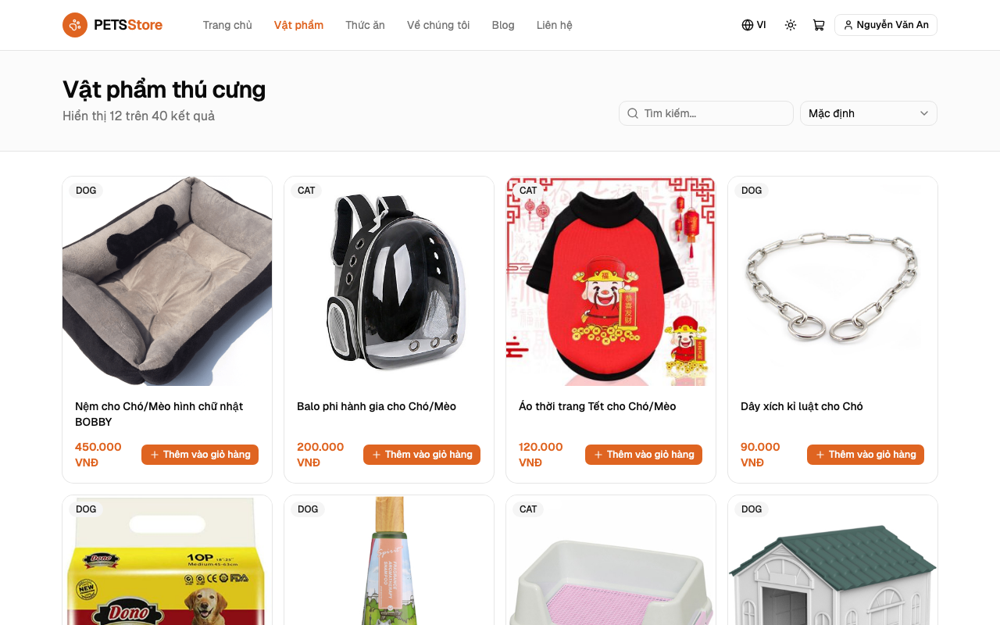
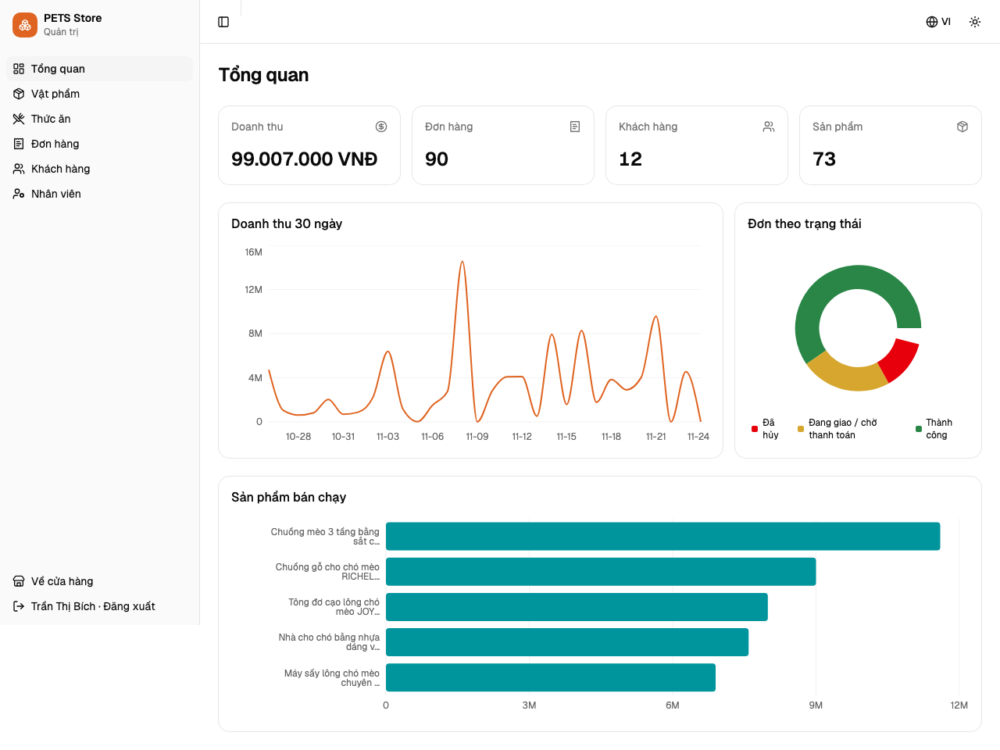

# PetStore

Online pet shop: a catalog of pet food and supplies, a cart, orders and an admin back office.
Started as a graduation project (Spring MVC + JSP), now being modernized into a product with a
REST API for a React front end. The original JSP site still runs next to the API until React replaces it.

## Live demo

**https://petstore.nqcdan.com** (shop, cart, checkout, order history) and **https://petstore.nqcdan.com/admin** (back office).
Sign in goes through Keycloak SSO. Use the shared demo accounts, they are public:

| Account | Password | Can do |
|---|---|---|
| `demo-user` | `Demo@123` | Shop, cart, checkout, own orders |
| `demo-admin` | `Demo@123` | Everything above plus `/admin`: dashboard, products and foods, orders, customers, employees |

Data is demo data and is reset from time to time.

| Shop | Admin dashboard |
|---|---|
|  |  |

More screenshots are in [`web/docs`](web/docs). Architecture and the SSO login flow:
[deployment](docs/architecture/petstore-deployment-architecture.png),
[SSO flow](docs/architecture/petstore-sso-login-flow.png).

## Stack

- Java 21, Spring Boot 3.5 (Spring MVC, Spring Data JPA, Spring Security)
- Auth: Keycloak (OIDC). The API is an OAuth2 resource server and never issues tokens
- Database: PostgreSQL in every environment (dev, tests, production), schema managed by Liquibase
- API docs: springdoc OpenAPI
- Packaging: executable WAR (the legacy JSP views need it), Docker image for linux/amd64 and linux/arm64

## Quick start

The only requirement is Docker (with buildx and compose v2): no JDK, Maven, Node or pnpm on the machine.
Every build, test, lint, e2e and code generation step runs in a container, and `make` is the single entry point
(CI runs the same targets).

```sh
make up         # PostgreSQL + Keycloak + app + web, built from the Dockerfiles
make test       # web lint + vitest, backend mvnw verify against a throwaway PostgreSQL
make e2e        # Playwright against the real stack (rewrites web/docs/*.png)
make gen-api    # regenerate web/src/api/schema.d.ts from the running app (after make up)
make images     # app + web images for linux/amd64 and linux/arm64, tagged with the git sha and latest
make down       # stop the stack and delete its volumes
```

| Service | URL |
|---|---|
| Web (React) | http://localhost:3000 |
| Legacy JSP site | http://localhost:8081 |
| OpenAPI UI | http://localhost:8081/swagger-ui.html |
| OpenAPI JSON | http://localhost:8081/v3/api-docs |
| Keycloak (dev mode) | http://localhost:8180 |

Images come only from `docker buildx` with the Dockerfiles (`Dockerfile`, `web/Dockerfile`): base images are pinned by
digest, the build is multi-stage with a BuildKit cache for Maven and pnpm, the runtime stage is non-root, and the OCI
labels (`revision`, `version`) carry the git sha. `docker-compose.yml` names the same images (`petstore:<sha>`), so
`docker compose build` produces what `make images` publishes. `make images PUSH=1 REGISTRY=ghcr.io/<owner>/` pushes;
the web image bakes the Keycloak URL in, set `VITE_KEYCLOAK_URL` for the target environment
(`VITE_KEYCLOAK_URL=https://sso.example.com make images`).

The first multi-architecture build needs QEMU for the foreign architecture (Docker Desktop and OrbStack include it).
If `make images` complains about the driver, run `make builder` once.

## Shared public demo accounts

The Keycloak realm `petstore` (`keycloak/petstore-realm.json`) ships two accounts for a shared public demo.
Anyone can use them, so never treat them as private.

| Username | Password | Role |
|---|---|---|
| `demo-user` | `Demo@123` | customer |
| `demo-admin` | `Demo@123` | admin |

## Configuration

All settings are environment variables.

| Variable | Default | Purpose |
|---|---|---|
| `SPRING_PROFILES_ACTIVE` | none | `prod` (set in the image) hardens cookies, hides Swagger and removes the default DB password |
| `DB_URL`, `DB_USERNAME`, `DB_PASSWORD` | `jdbc:postgresql://localhost:5432/petstore`, `petstore`, `petstore` | PostgreSQL connection (`prod` has no default password) |
| `KEYCLOAK_ISSUER_URI` | `http://localhost:8180/realms/petstore` | Token issuer, must equal the `iss` claim |
| `SPRING_SECURITY_OAUTH2_RESOURCESERVER_JWT_JWK_SET_URI` | derived from the issuer | Optional internal URL for the signing keys |
| `KEYCLOAK_API_CLIENT_ID` | `petstore-api` | Required token audience; its client roles are also read from the token |
| `PETSTORE_CORS_ORIGINS` | `http://localhost:3000,http://localhost:5173` | Allowed front-end origins |
| `PETSTORE_SEED_DEMO` | `true`, `false` (`prod`) | Load demo customers, employees and orders (dated over the last 30 days from the start time) on an empty database |
| `MAIL_USERNAME`, `MAIL_PASSWORD` | empty | SMTP login for the legacy JSP mail features (for Gmail use an app password) |
| `PETSTORE_API_DOCS` | `true`, `false` (`prod`) | Publish the OpenAPI document and Swagger UI |
| `SERVER_PORT` | `8081` | HTTP port |

The product and food catalog is always seeded by Liquibase (`src/main/resources/db/changelog`).

## REST API

Base path `/api/v1`, JSON, paginated lists take `page`, `size` and `sort`.

| Area | Endpoints | Access |
|---|---|---|
| Catalog | `GET /products`, `/products/{id}`, `/foods`, `/foods/{id}` (filters `q`, `type`), `GET /photos/**` (uploaded images), `POST /contact` (contact form) | public |
| Shop | `GET /me`, `POST /cart/quote`, `POST /orders` (optional `paymentMethod` COD or ATM, default COD), `GET /orders`, `GET /orders/{code}` | role `customer` or `admin` |
| Admin | `/admin/products`, `/admin/foods`, `/admin/customers`, `/admin/employees` (CRUD, search, product images via multipart `POST .../{id}/image`), `/admin/orders` (list by state, detail, `PATCH .../state`), `GET /admin/stats` | role `admin` |

Access tokens must carry `petstore-api` in `aud` (the realm adds it to tokens of `petstore-web` with an audience mapper). Keycloak realm roles `customer` and `admin` (and client roles of `petstore-api`) map to `ROLE_CUSTOMER` and `ROLE_ADMIN`.
Everything the front end needs is under `/api`, so a reverse proxy only has to forward that prefix. The contact form is always stored and also mailed to `MAIL_USERNAME` when SMTP is set. Orders belong to the Keycloak subject (`sub`) of the token, never to a username. Quantity is 1 to 100 per item and an order total must fit an integer (400 otherwise); order states move DUE to PAID or CANCEL, PAID to CANCEL, CANCEL is final (409 otherwise). Uploaded images must be PNG, JPEG or WebP (checked by content, up to 2 MB). The cart lives in the client; `POST /cart/quote` prices it with catalog prices and `POST /orders` always re-prices server side.

The React front end signs in with the public client `petstore-web` (authorization code flow with PKCE, for example with
`keycloak-js` or `oidc-client-ts`) and sends the access token as `Authorization: Bearer <token>`.

### Pointing at a real Keycloak

1. Import `keycloak/petstore-realm.json` into your Keycloak (or recreate the realm `petstore`, clients `petstore-web` and `petstore-api`, realm roles `customer` and `admin`). The file contains `${PETSTORE_WEB_ORIGIN}` and `${PETSTORE_WEB_ORIGIN_ALT}` placeholders that Keycloak fills from environment variables when started with `--import-realm`.
2. Set `KEYCLOAK_ISSUER_URI` to `https://<keycloak-host>/realms/petstore`.
3. Remove the two demo users if the instance is not a public demo.

## Tests

`make test` runs the web lint and vitest suite, then `./mvnw verify` in a JDK container next to a throwaway
PostgreSQL 16 (tmpfs, removed afterwards). The backend suite starts the full application and covers the Liquibase
seed, public catalog, token handling (JWT test fixtures, no Keycloak needed), 401/403 rules, admin CRUD, image upload,
contact form, demo data and statistics. `make e2e` drives the React app in Playwright against the real stack
(PostgreSQL, Keycloak, app) with the demo accounts.

## Deployment

See [deploy/README.md](deploy/README.md) for the single-VM Docker Compose setup behind a reverse proxy.

## Project layout

```
src/main/java/com/fpt/petstore
  api/          REST API (controllers, services, DTOs, resource server config)
  controller/   legacy JSP controllers
  entities/ repository/ services/   domain model and persistence
src/main/resources/db/changelog     Liquibase changelog and catalog seed data
src/main/webapp/WEB-INF/jsp         legacy JSP views
keycloak/       realm import
deploy/         production compose file and runbook, dev nginx conf
web/            React front end
Dockerfile, web/Dockerfile, docker-bake.hcl, docker-compose*.yml, Makefile   build, test and run
```

## Notes

- The legacy JSP site keeps its own session login and plain-text demo passwords; it is temporary and is not exposed by the API.
- If an older commit of this repository contained a Gmail password, rotate it; removing it from the current files does not remove it from git history.
